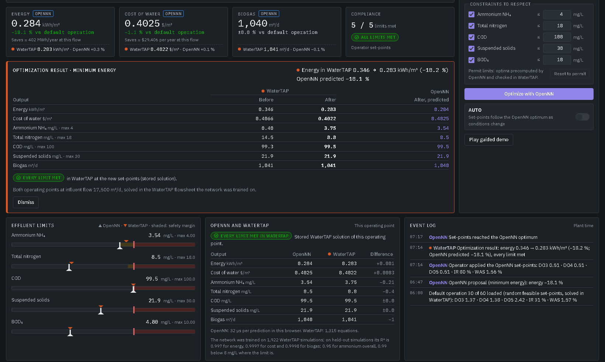
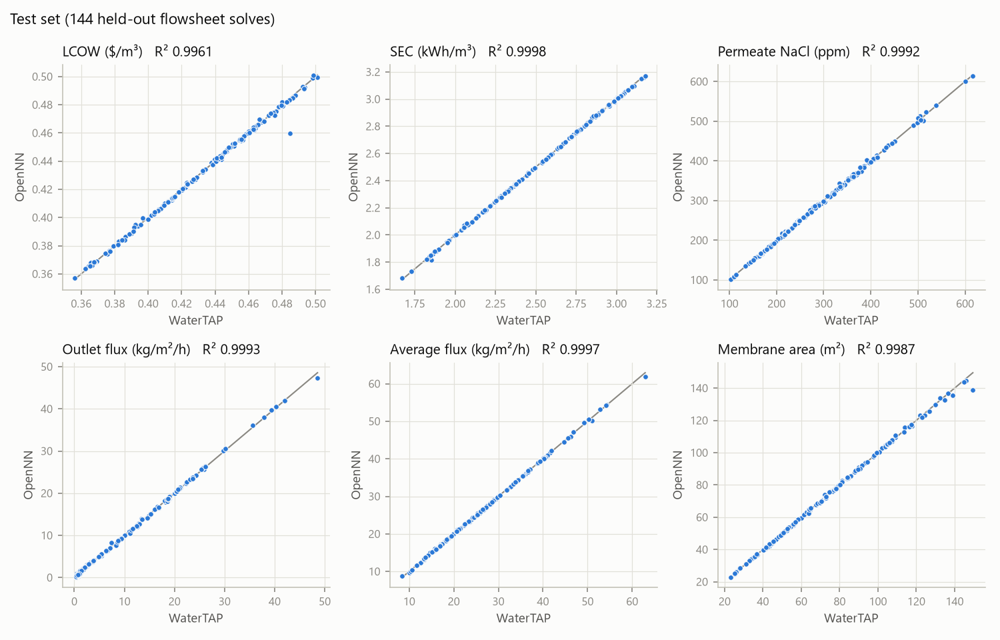
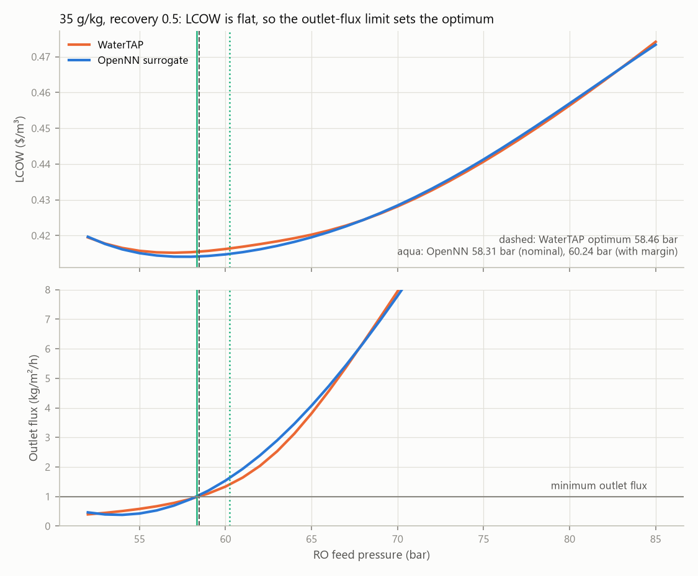
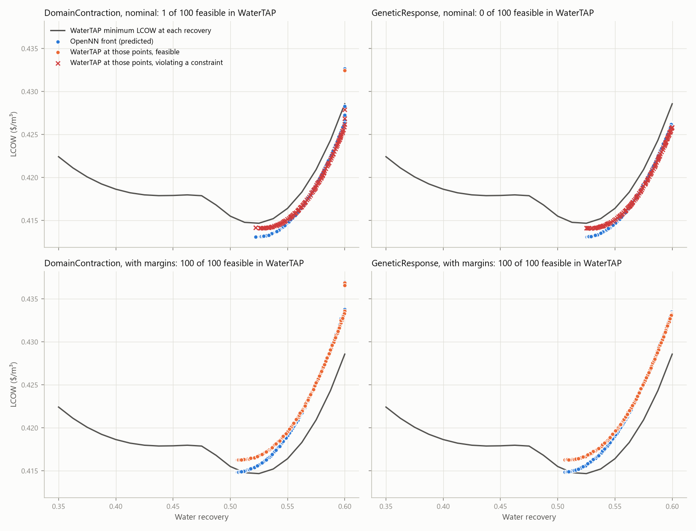

# opennn-watertap-demo

Neural-network surrogates of WaterTAP water-treatment flowsheets (seawater RO with pressure exchanger, BSM2 activated sludge), trained and optimized with OpenNN, with a browser control-room demo that runs the networks next to a live WaterTAP simulator.



## Quick start

**The page alone.** Open [`to_show/water_treatment_hmi.html`](to_show/water_treatment_hmi.html) in a browser. It is one self-contained file that runs offline and carries WaterTAP's solutions for the stored operating points.

**The page with WaterTAP running beside the network.** Clone or download this repository, then:

| | Windows | Linux, macOS |
|---|---|---|
| Once | double-click `setup.bat` | `./setup.sh` |
| Each time | double-click `start_demo.bat`, or open the HTML file and press **Start WaterTAP** | `./start_demo.sh` |

Setup creates the Python environment (WaterTAP 1.8.0 and IDAES 2.13, about 1 GB, a few minutes), fetches the IPOPT solver, connects the page's **Start WaterTAP** button (Windows), and checks that both WaterTAP models solve. Without conda on the computer, `setup.bat` offers to install Miniforge for the current user. On Linux, IPOPT needs the Fortran runtime, LAPACK, BLAS and OpenMP libraries; when they are missing, `setup.sh` installs them with `apt-get` if it runs as root, and otherwise puts conda-forge's copies into `.venv` (no sudo needed). `start_demo` serves the page at http://127.0.0.1:8765/ and solves every operating point in WaterTAP next to the network; closing its window (or Ctrl+C) stops it. [`to_show/README.md`](to_show/README.md) explains the page, the simulator and how the networks, optima and page are rebuilt. Coding agents: [AGENTS.md](AGENTS.md).

**Requirements.** The page needs a browser; the simulator needs the environment that setup creates (Windows, Linux or macOS, Python 3.11 to 3.13). Rebuilding the networks also needs Visual Studio 2022 or later, or its Build Tools, with the "Desktop development with C++" workload: `build_surrogates.bat` downloads OpenNN from GitHub and builds it with the two C++ trainers (about 15 minutes the first time). See [Setup](#setup).

**Licence.** The code and data in this repository are under the MIT licence ([LICENSE](LICENSE)). The C++ trainers link OpenNN, which is licensed separately (AGPL-3.0 for current versions). WaterTAP, IDAES and Pyomo are BSD-licensed. No executables are included.

## The toys

This repository holds three related toys and the demo:

| Toy | Where | What |
|---|---|---|
| Reverse osmosis | this README | WaterTAP RO with energy recovery: 3 inputs, 6 outputs, 7 scenarios checked in WaterTAP |
| BSM2, steady state | [bsm2_steady/](bsm2_steady/README.md) | WaterTAP's steady-state BSM2 plant (activated sludge + digester): 6 inputs, 8 outputs, effluent limits |
| BSM2, dynamic | [bsm2_dynamic/](bsm2_dynamic/README.md) | plan and building block for the dynamic IWA benchmark (bsm2-python) with OpenNN |
| Control-room demo | [to_show/](to_show/README.md) | `water_treatment_hmi.html`: one offline page with both plants, the OpenNN networks running in the browser, OpenNN-optimized set-points checked in WaterTAP, limits you can change, a storm switch with its own wet-weather network, a guided demo, and the WaterTAP simulator beside the network when the local service runs |

The rest of this README covers the reverse osmosis toy.

# Reverse osmosis toy: WaterTAP → OpenNN → response optimization

A seawater reverse osmosis (RO) plant is simulated with [WaterTAP](https://watertap.readthedocs.io/en/latest/getting_started.html).
The steps are:

1. Sample the flowsheet into a dataset.
2. Train an OpenNN surrogate on that dataset.
3. Run OpenNN response optimization on the surrogate.
4. Check every answer back in WaterTAP, against WaterTAP's own optimizer.

Because the true model is available, each surrogate answer can be scored for optimality and feasibility.

## The flowsheet

`watertap.flowsheets.RO_with_energy_recovery`, as shipped with WaterTAP 1.8.0, has these settings:

- 0D RO with calculated concentration polarization and pressure drop.
- NaCl property package.
- Pressure exchanger with a booster pump.
- `WaterTAPCosting`.
- Feed of 1e-3 m³/s at 25 °C.

The membrane area is free, so fixing salinity, recovery and pressure gives one solution.

| Variable | Role | Unit | Dataset range |
|---|---|---|---|
| `salinity` | input | g/kg (NaCl mass fraction × 1000) | 25 to 45 |
| `recovery` | input | water mass recovery | 0.35 to 0.60 |
| `pressure` | input | high-pressure pump outlet, bar | 0.88 × brine osmotic pressure to 85 |
| `lcow` | output | levelized cost of water, $/m³ | 0.355 to 0.532 |
| `sec` | output | specific energy consumption, kWh/m³ | 1.63 to 3.23 |
| `permeate_ppm` | output | permeate NaCl, mg/kg | 96 to 679 |
| `flux_out` | output | water flux at the RO outlet, kg/m²/h (WaterTAP's minimum-flux constraint uses this one) | 0.36 to 52 |
| `flux_avg` | output | average water flux, kg/m²/h | 8.4 to 64 |
| `area` | output | membrane area, m² | 20 to 159 |

The data reach 0.88 × the brine osmotic pressure because WaterTAP's own optimum sits at about 1.01 ×, on the outlet-flux limit of 1 kg/m²/h. About 24% of the samples have an outlet flux below that limit, so the surrogate learns the boundary from both sides.

## Setup

`setup.bat` (or `setup.sh`) builds the environment as [Getting Started](https://watertap.readthedocs.io/en/latest/getting_started.html) describes, with the versions pinned in `environment.yml` and `requirements.txt`. By hand:

```
conda env create -f environment.yml
conda run -n watertap idaes get-extensions
```

The versions are those installed on 2026-10-22:

- watertap 1.8.0, idaes-pse 2.13.0, pyomo 6.10.1, on Python 3.11.
- IDAES extensions 3.4.2, in `%LOCALAPPDATA%\idaes` (Linux and macOS: `~/.idaes`).

The OpenNN side: `build_surrogates.bat` builds the two trainers, `model/ro_surrogate.exe` and `bsm2_steady/model/bsm2_surrogate.exe`, through `CMakeLists.txt`. It downloads OpenNN 26.0.3 from GitHub (`master` at `ad4dd0759`) and builds it with them, so the trainers are always compiled like the library; `model\build.bat` builds this trainer alone. To build against another OpenNN source tree, set `OPENNN_SOURCE_DIR`, with a `BUILD_DIR` of its own. The networks, optima and checks in this repository were made with OpenNN `dev` at `31da51dbd`, a development commit that is not on GitHub.

## Running

`run_all.bat` runs everything. The steps and their times on this laptop (i7-8550U) are:

| Step | Command | Writes | Time |
|---|---|---|---|
| 1. Dataset | `python generate_dataset.py 1000 6` | `data/ro_dataset.csv`, `data/ro_samples_log.csv` | 30 min |
| 2. Build | `model\build.bat` | `model/ro_surrogate.exe` | about 15 min the first time (OpenNN), then 1 min |
| 3. Train | `ro_surrogate train <root>` | `model/ro_network.json` + `.bin`, `model/constraint_margins.csv`, `results/test_predictions.csv` | 2 s |
| 4. Optimize | `ro_surrogate optimize <root>` | `results/opennn_optima.csv`, `results/pareto_*.csv` | 2 min |
| 5. Check in WaterTAP | `python verify_optima.py 6` | `results/comparison.md` / `.csv`, `results/pareto_check.csv`, `results/watertap_lcow_by_recovery.csv` | 10 min |
| 6. Figures | `python plots.py 6` | `figures/*.png` | 1 min |

Python is the `watertap` environment's `python.exe`. `ro_flowsheet.py` holds the WaterTAP wrapper that all the scripts share. `ro_surrogate predict <root> in.csv out.csv` evaluates the saved network on any inputs.

## Dataset

The inputs were a Latin hypercube of 1000 points over salinity, recovery and the pressure's position in its range. Of these, 964 solved. The 36 failures all sit at the low-pressure edge (position < 0.08), where the RO model reaches its own flux floor of 1e-4 kg/m²/s. They are listed in `data/ro_samples_log.csv`.

## Surrogate

The network is OpenNN's `ApproximationNetwork` with 3 inputs, 32 tanh units and 6 outputs. Training details:

- Normalized squared error with L2 regularization of 1e-4.
- QuasiNewton for 3000 epochs.
- Random 70/15/15 split.
- The hidden size (8, 16, 24 or 32) was chosen by the worst validation R² across outputs.

Test R² (1 − SSres/SStot, 144 held-out solves):

| lcow | sec | permeate_ppm | flux_out | flux_avg | area |
|---|---|---|---|---|---|
| 0.9961 | 0.9998 | 0.9992 | 0.9993 | 0.9997 | 0.9987 |



## Response optimization scenarios

Every scenario keeps the limits of WaterTAP's `optimize_set_up`: permeate ≤ 500 ppm, outlet flux ≥ 1 kg/m²/h, and pumps ≤ 80 bar. They also keep a domain guard (see below).

| | Problem |
|---|---|
| S1 | 35 g/kg, recovery 0.5, minimum LCOW. This is WaterTAP's own `optimize_set_up` problem. |
| S2 | 35 g/kg, minimum LCOW, with recovery and pressure free. |
| S2b | S2 without the domain guard. |
| S3 | 35 g/kg, minimum SEC with average flux ≥ 20 kg/m²/h. |
| S4 | 44 g/kg, minimum LCOW with a 70 bar pump. |
| S5 | 35 g/kg, maximum recovery with LCOW ≤ 0.420 $/m³. |
| S6 | 35 g/kg, minimum LCOW and maximum recovery (a Pareto front of 100 points). |

Each scenario runs with both OpenNN optimizers: `DomainContraction` and `GeneticResponse`. They agree to about four digits.

Each scenario also runs a second time with margins (`_margin`). Each output bound is tightened by the 95th percentile of the validation error among samples within a factor of two of the bound. The margins come out as:

- `flux_out`: +0.63 kg/m²/h.
- `permeate_ppm`: −7.8 ppm.
- `flux_avg`: +0.31 kg/m²/h.
- `lcow`: −0.0017 $/m³.

WaterTAP's reference optimum is IPOPT on the full flowsheet with the same limits. For free-recovery scenarios it comes from three starting recoveries, a 21-point recovery grid of fixed-recovery solves, and a final solve started from the best grid point. The best of these is kept. Only recovery and pressure are free, so the grid makes the reference global.

## Results

These are WaterTAP's values at OpenNN's answers, using `DomainContraction`; `GeneticResponse` gives the same within 0.01%. The full table is in `results/comparison.md`.

| | WaterTAP optimum | OpenNN, nominal limits | OpenNN, with margins |
|---|---|---|---|
| S1 LCOW | 0.4155 (58.46 bar) | 0.4155 (−0.01%), **outlet flux 2.5% below limit** | 0.4164 (+0.22%), feasible |
| S2 LCOW | 0.4147 (r 0.521, 60.7 bar) | 0.4142 (−0.12%), **outlet flux 7.8% below** | 0.4163 (+0.40%), feasible |
| S2b LCOW | 0.4147 | identical to S2 | (not run) |
| S3 SEC | **2.2843** (r 0.35, 56.0 bar); IPOPT alone finds 2.3528 | 2.2916 (+0.32%), feasible | 2.2993 (+0.65%), feasible |
| S4 LCOW | 0.4702 (r 0.476, 70 bar) | 0.4700 (−0.05%), **outlet flux 2.5% below** | 0.4729 (+0.59%), feasible |
| S5 recovery | 0.5709 | 0.5785 (1.3% more than possible), **outlet flux 11.6% below** | 0.5456 (4.4% less), feasible |
| S6 front | (WaterTAP minimum LCOW at each recovery) | **1 of 200 points feasible** | 200 of 200 feasible, LCOW median +0.84 to +0.88% above the true front (worst +1.94%) |

A negative gap with nominal limits does not mean OpenNN beat WaterTAP. Those points are slightly infeasible, and that is how they come out cheaper.





## What the toy shows

1. **The surrogate is accurate enough to optimize the objective.** Every OpenNN answer lands within 0.65% of WaterTAP's best LCOW or SEC. LCOW is very flat near the optimum (0.4155 to 0.4176 $/m³ between 55 and 62 bar), so the precision that matters is in the constraints.
2. **Optima sit on an output constraint, and surrogate error there becomes infeasibility.** The outlet-flux limit is active at almost every optimum. The search finds the surrogate's boundary exactly, and an error of 0.03 to 0.12 kg/m²/h puts the true flux 2.5 to 11.6% below 1. Backing off each output bound by its validation error made every answer feasible. The cost was 0.2 to 0.7% in LCOW or SEC. The flux margin is conservative: it is effectively the worst of 36 validation points near the bound, so S5 gives up 4.4% of the achievable recovery. More data near the bound, or training on log(flux), would tighten it. Tuning the margin on the WaterTAP results would be cheating.
3. **A global search on the surrogate can beat a local solver on the true model.** In S3, IPOPT on WaterTAP converges to recovery 0.537 (2.3528 kWh/m³) from every start, including a start at 0.35. The SEC landscape along the flux constraint has two basins. OpenNN's sampling search found the low-recovery basin: 2.2916 kWh/m³, within 0.32% of the grid-certified minimum of 2.2843.
4. **The search box is the training split's range, not the dataset's.** With 45 g/kg (the dataset maximum), OpenNN refused with `The constraints leave 'salinity' with an empty range [45, 44.9756]`. The largest salinity in the training split was 44.976, so S4 uses 44 g/kg.
5. **The domain guard was not needed here.** The no-data corner of the input box (low pressure at high salinity and recovery) is cut off by `pressure*(1 - recovery)/salinity >= 0.7286`, the smallest value in the data. The outlet-flux constraint already keeps the search out of that corner, so S2 and S2b give the same answer. The guard would matter for a problem without that constraint.

## Files

| Path | Contents |
|---|---|
| `ro_flowsheet.py` | WaterTAP wrapper: one-point solve, dataset sample, scenario optimum |
| `generate_dataset.py` | Latin hypercube sampling in parallel workers |
| `model/main.cpp`, `model/build.bat` | OpenNN training, response optimization scenarios, prediction |
| `CMakeLists.txt`, `build_surrogates.bat` | builds both toys' trainers with OpenNN from GitHub |
| `verify_optima.py` | WaterTAP check of every answer and WaterTAP's reference optima |
| `plots.py` | the three figures |
| `run_all.bat` | the whole pipeline |
| `data/`, `model/`, `results/`, `figures/` | outputs of the run on 2026-10-22 |
