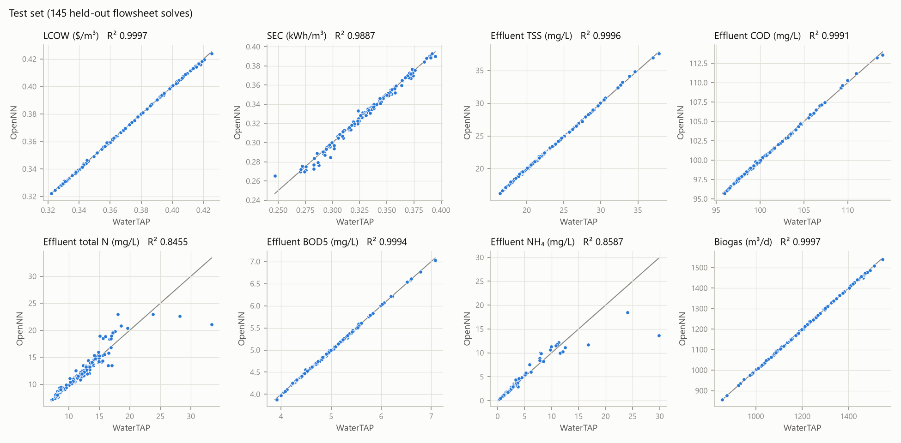
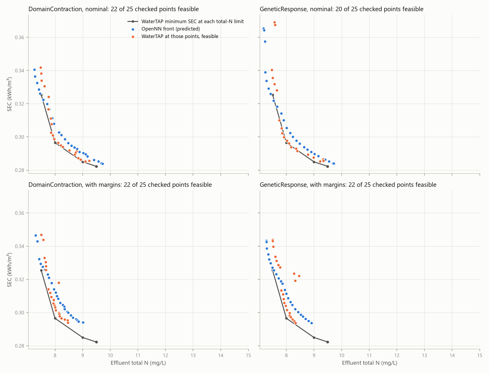

# BSM2 steady state: WaterTAP → OpenNN → response optimization

This toy applies the pipeline of the reverse osmosis toy (`../README.md`) to a whole wastewater plant: WaterTAP's steady-state BSM2.

1. Sample the flowsheet into a dataset.
2. Train an OpenNN surrogate.
3. Run response optimization within the BSM2 effluent limits.
4. Check every answer in WaterTAP against WaterTAP's own optimizer.

One infill round shows how to repair a surrogate where the optimizer exploits its error.

## The flowsheet

The flowsheet is `watertap.flowsheets.full_water_resource_recovery_facility.BSM2` from WaterTAP 1.8.0:

- primary clarifier;
- five ASM1 reactors: two anoxic, then three aerated;
- secondary clarifier;
- thickener, ADM1 anaerobic digester and dewatering;
- `WaterTAPCosting`.

It is the BSM2 layout at steady state, with clarifiers given as fixed split fractions, 35 °C throughout and WaterTAP's own defaults. It is not the dynamic IWA benchmark protocol; for that, see `../bsm2_dynamic`.

| Variable | Role | Unit | Range |
|---|---|---|---|
| `do3`, `do4`, `do5` | input | DO set-points in the aerated reactors R3–R5, mg/L | 0.5 to 3.0 |
| `recycle` | input | internal (nitrate) recycle, fraction of the R5 outflow | 0.3 to 0.8 |
| `wastage` | input | wasted fraction of the secondary-clarifier underflow (sludge age) | 0.006 to 0.025 |
| `influent` | input (disturbance, fixed per scenario) | influent flow, m³/d | 16,500 to 24,800 (base 20,648) |
| `lcow` | output | levelized cost of water, $/m³ of influent | 0.32 to 0.43 |
| `sec` | output | specific energy consumption, kWh/m³ of influent | 0.23 to 0.42 |
| `tss`, `cod`, `tn`, `bod5`, `nh4` | output | effluent concentrations, mg/L | see `data/` |
| `biogas` | output | digester gas, m³/d | 830 to 1,565 |

The effluent limits are the BSM2 ones, all in mg/L: TSS ≤ 30, COD ≤ 100, total N ≤ 18, BOD5 ≤ 10 and NH₄ ≤ 4.

## Two things the flowsheet needed

1. **Washout.** Steady-state ASM1 always has a second solution with no nitrifiers (X_BA = 0). A warm-started solve can jump onto it even where nitrification is sustainable: DO 3 mg/L gave NH₄ 41 mg/L that way.

   `bsm2_flowsheet.Plant` prevents this in three ways:
   - a floor of 1 g/m³ on the autotrophs in all five reactors;
   - continuation: each new point is reached in steps of at most 25% of each range, halved on failure;
   - a restart from the base case when a walk fails.

   A point is labelled `washout` only when the nitrifying branch cannot be reached at all. It then gets the solution without the floor and stays in the dataset.

2. **Path dependence.** Some points near internal recycle 0.8 are reached only along certain paths. When both straight walks fail, the evaluator moves one input at a time from the base case (forward, then reverse order). This fallback was added after the first check of round 1, where it rescued 7 of the 8 OpenNN answers that WaterTAP had failed to solve. The round-0 check ran without it.

## Setup and running

The setup is the same as for the reverse osmosis toy: the environment from `..\setup.bat`, and `model\build.bat`, which builds `bsm2_surrogate.exe` with OpenNN through `..\build_surrogates.bat` (see the [main README](../README.md#setup)). The results here were made with OpenNN `dev` 31da51dbd. `run_all.bat` runs the base pipeline (round 0). The infill round is run by hand.

| Step | Command | Time (i7-8550U) |
|---|---|---|
| Dataset | `python generate_dataset.py 800 6 20` | 1 h 54 min |
| Build | `model\build.bat` | about 10 min the first time (OpenNN), then 1 min |
| Train | `bsm2_surrogate train <root> [dataset file]` | 5 s |
| Optimize | `bsm2_surrogate optimize <root>` | 4 min |
| Check in WaterTAP | `python verify_optima.py 6` | 25 min |
| Infill | `python infill.py 6`, then train on `bsm2_dataset_infill.csv`, optimize and check again | 15 min + the above |
| Figures | `python plots.py` | 10 s |

Each solve costs 3–6 s even warm, because Pyomo writes the whole BSM2 model to IPOPT for every solve.

Round 0 (before infill) is kept in `results_round0/` and `model_round0/`. `results/` and `model/` hold round 1.

## Data

The inputs were a Latin hypercube of 800 points, visited along a nearest-neighbour path so that each continuation step is short:

| Status | Points | Notes |
|---|---:|---|
| Nitrifying | 757 | |
| Washout | 13 | all at wastage 0.021–0.025 with high influent, i.e. short sludge age; kept |
| Failed | 30 | scattered numerical failures, mostly at high recycle and low wastage; dropped |

COD is the tightest limit: 44% of rows meet it, and 253 of 770 rows meet all five limits.

The infill round added 200 rows: 199 nitrifying and 1 washout, with 19 failures out of 219 attempts. Their locations were:

- every round-0 OpenNN answer;
- 25 points from each Pareto front;
- 4 random neighbours of each answer, within ±8% of each decision's range.

## Surrogate

The network is OpenNN's `ApproximationNetwork` with 6 inputs, 24 (round 0) or 32 (round 1) tanh units and 8 outputs. Training uses normalized squared error with L2 regularization of 1e-4, QuasiNewton, and a random 70/15/15 split.

Effluent total N and NH₄ use OpenNN's `Logarithm` scaler, because NH₄ runs from 0.1 to 41 mg/L. This cut the 95th-percentile validation error near the 4 mg/L limit from 2.3 to 1.4 mg/L.

Test R² (1 − SSres/SStot):

| Round | Rows | lcow | sec | tss | cod | tn | bod5 | nh4 | biogas |
|---|---:|---|---|---|---|---|---|---|---|
| 0 | 770 | 0.9995 | 0.9738 | 0.9995 | 0.9989 | 0.7409 | 0.9991 | 0.7835 | 0.9996 |
| 1 | 970 | 0.9997 | 0.9887 | 0.9996 | 0.9991 | 0.8455 | 0.9994 | 0.8587 | 0.9997 |

The low R² for total N and NH₄ comes from the washout edge. In round 0, the 104 test points with NH₄ ≤ 8 mg/L have:

- NH₄: R² 0.982 and a mean absolute error of 0.09 mg/L;
- total N: R² 0.94 and 0.33 mg/L.

The 11 points toward washout miss by about 6 mg/L. The two rounds use different test splits.

## Scenarios

Each scenario holds the influent fixed and imposes the BSM2 effluent limits:

| | Problem |
|---|---|
| B1 | Nominal influent, minimum LCOW |
| B2 | Nominal influent, minimum SEC |
| B3 | 17,500 m³/d, minimum SEC |
| B4 | 24,000 m³/d, minimum SEC |
| B5 | Nominal influent, maximum biogas |
| B6 | Nominal influent, minimum SEC and minimum total N (Pareto front of 100 points); the total-N limit is lifted |

Each scenario also runs with margins (`_margin`): every output limit is tightened by the 95th percentile of the validation error within a factor of two of the limit. Round 1's margins were TSS 0.28, COD 0.30, total N 1.46, BOD5 0.03 and NH₄ 1.23 mg/L.

WaterTAP's reference optimum is IPOPT on the flowsheet over the same five decisions and ranges, started from the base case and four Latin-hypercube points, keeping the best. The true B6 front is minimum SEC subject to total N ≤ ε.

| | WaterTAP optimum |
|---|---|
| B1, B2 | DO 0.69 / 0.81 / 0.83, recycle 0.80 (bound), wastage 0.0172: LCOW 0.3607, SEC 0.2823; NH₄ (4.00) and COD (100.0) active |
| B3 | DO at the 0.5 floor in all three tanks, recycle 0.80, wastage 0.0158: SEC 0.2822 |
| B4 | DO 1.26 / 1.45 / 1.54, recycle 0.80, wastage 0.0188: SEC 0.2951 (only 2 of 5 starts converged) |
| B5 | DO 3.0 / 3.0 / 2.2, recycle 0.80, wastage 0.025 (bound): 1336 m³/d |
| B6 | Total N 7.5 → SEC 0.3255; 8.0 → 0.2965; 9.0 → 0.2850; 9.49 or more → 0.2823. No solution below 7.5 |

## Results

The tables show WaterTAP's value at OpenNN's answer, compared with WaterTAP's optimum (`DomainContraction`; `GeneticResponse` agrees unless noted). The full tables are in `results_round0/comparison.md` and `results/comparison.md`.

**Before infill (round 0, 770 rows)**

| | Nominal limits | With margins |
|---|---|---|
| B1 LCOW | **NH₄ 24.5 mg/L** (limit 4) | +0.25%, feasible |
| B2 SEC | **NH₄ 22 mg/L** | +3.7%, feasible |
| B3 SEC | **NH₄ 9.0–9.4 mg/L** | NH₄ 4.4% over (`GeneticResponse`: flowsheet failed) |
| B4 SEC | +2.4%, COD 0.2% over | +9.5%, feasible |
| B5 biogas | within 0.03%, feasible | within 0.04%, feasible |
| B6 front (25 points checked) | 16–17 feasible, SEC median +2.4 to 3.4% above the true front | 20–22 feasible, median +3.2 to 7.5% |

**After one infill round (round 1, 970 rows)**

| | Nominal limits | With margins |
|---|---|---|
| B1 LCOW | +0.11%, feasible (`GeneticResponse`: NH₄ 0.7% over) | +0.35%, feasible |
| B2 SEC | +1.0%, feasible | +4.1%, feasible |
| B3 SEC | −0.1%, NH₄ 4.3% over (`GeneticResponse`: 6.6%) | +1.6%, feasible |
| B4 SEC | +1.2%, feasible | +8.0%, feasible |
| B5 biogas | within 0.01%, feasible | within 0.01%, feasible |
| B6 front (25 points checked) | 20–22 feasible, median +0.45 to 0.56% | 22 feasible, median +1.8 to 2.3% |

Before infill: [figures/pareto_round0.png](figures/pareto_round0.png), [figures/parity_round0.png](figures/parity_round0.png).

## What the toy shows

1. **Operation barely moves the cost of water here, but energy moves a lot.** Optimizing operation lowers LCOW by only 0.7% (0.3632 at the base case to 0.3607). At the same point SEC falls 15% (0.334 to 0.282). The optimum sits where NH₄ and COD reach their limits.
2. **Before infill, the optimizer exploited the surrogate at a cliff.** Minimum energy pushes DO down, and at nominal load nitrification collapses steeply as DO approaches 0.5 mg/L. With sparse data in that corner (all three DO low, low recycle), the surrogate predicted NH₄ 4 mg/L where WaterTAP gives 22–25. All three DO set-points went to the 0.5 floor. Validation-error margins rescued B1 and B2, but not low load (B3).
3. **One infill round fixed it.** Solving WaterTAP where the optimizer went, and around those points, added 200 rows. After retraining:
   - The minimum-energy answers (B2, B3) took WaterTAP's structure: recycle 0.8 and DO 0.5–1.2.
   - All answers are within 1.3% of WaterTAP's optimum and feasible or within 0.7% of a limit, except low load, which is 4–7% over on NH₄.
   - With margins, every answer WaterTAP could solve was feasible, at a cost of +0.01 to 8%.
   - The Pareto fronts went from 16–17 to 20–22 feasible points out of 25, and their median distance to the true front fell from about 3% to under 0.6%.
4. **Where the response is smooth, the surrogate is as good as the flowsheet optimizer.** Maximum biogas lands within 0.01–0.04% of WaterTAP's optimum in both rounds. WaterTAP's own IPOPT failed from 3 of 5 starts at high load, so a sampling-based search on a surrogate is also a useful robustness check on the flowsheet optimizer.
5. **Margins are cheap or expensive depending on the scenario.** With the NH₄ margin of about 1.2–1.4 mg/L, minimum energy at high load pays 8%, because the optimum is pinned on NH₄. Biogas pays nothing, because its optimum is limited by wastage, not by an effluent limit.
